# Blender-referenced Studio interface

The user requested Blender as the reference for the entire interface after
the overall workspace redesign in `620b24e`. This iteration applies that
direction to the real native C++ application: achromatic editor surfaces,
compact controls, a narrow context header, and properties to the right of
the scene. The prior layout work remains the basis for task execution,
responsive pages, and bounded logs.

## Reference and adaptation

Color relationships were verified against Blender's official
[v4.5.0 default theme](https://github.com/blender/blender/blob/v4.5.0/release/datafiles/userdef/userdef_default_theme.c).
The file's blob SHA is `38f3135e9a980171bb5692d77a1b53cd2b3671e0`.
Editor structure follows the official documentation for
[window organization](https://docs.blender.org/manual/en/4.5/interface/window_system/introduction.html),
[regions](https://docs.blender.org/manual/en/4.5/interface/window_system/regions.html),
and [tabs and panels](https://docs.blender.org/manual/en/4.5/interface/window_system/tabs_panels.html).
These references establish visual grammar; Spirula retains its own tasks,
names, translated copy, embedded font chain, file types, and navigation rules.

| Role | Implemented treatment |
| --- | --- |
| Frame and editor | Neutral `#282828` framing and `#303030` content panels |
| Property groups | `#3D3D3D` headers; narrow `#161616` boundaries |
| Ordinary controls | `#545454` buttons, brighter neutral hover feedback |
| Input fields | `#1D1D1D` wells, `#181818` editing state |
| Typography | `#E6E6E6` primary text and `#B0B0B0` secondary text |
| Editable states | Blender blue `#4772B3` for primary actions and checked values |
| Selection and focus | Restrained `#FFA028` focus, tab-edge, and drag feedback |
| Tabs | Dark inactive tabs and a gray selected tab continuous with its editor |

The system maps all 61 color slots in the pinned Dear ImGui version.
White text on the primary blue has 4.85:1 contrast. Shared states that use
the ordinary `#E6E6E6` text instead use a darker blue, `#3D639C`, giving
4.86:1. Ordinary text on a `#545454` button has 6.07:1 contrast.
These are full-opacity color-pair calculations, not claims about disabled
controls or every possible composited scene.

ImGui geometry is adapted to this application, not asserted to be Blender's
native pixel units: window padding is 8 by 6 scaled pixels, frame padding
6 by 3, item spacing 6 by 4, and ordinary frame rounding 3. Fonts, language
coverage, and the existing UI-scale behavior stay intact. Splitter lines
are thinner while their existing drag hit areas remain unchanged.

## Workspace behavior

Home uses a compact product strip, recent files, and a 300-scaled-pixel command
column on wide windows. Command labels wrap as necessary; their existing
descriptions are available on hover, including when disabled. Compact windows
retain the wrapped command buttons above the recent list. Recent-row density
increases without removing the name, full-path tooltip, type, or time.

The shared workspace header uses normal UI type and a narrow darker strip.
Home, current task, and the middle-elided document path share that strip;
long context can move to a second line. It reports navigation to the caller,
which retains the existing busy and unsaved-document checks.

On wide preparation and training screens, Preview occupies the left side and
Settings/Metrics occupy the right. Their existing compact tabs remain below
the 960-scaled-pixel threshold. Model Edit and Render likewise place their
properties on the right, with the scene and render timeline on the left.
Mesh and Batch use the same shared theme and persistent action bands.

Drawing order and placement are deliberately distinct. Properties still
execute before the scene in the same frame, even though they appear on the
right. The divider stores the inspector width in the existing unscaled
preference: dragging left widens properties, dragging right widens the scene.
The existing minimum widths, log budget, and timeline reservations apply.

This is an interface change. Model rendering, camera geometry, screenshot
background, training, meshing, batch execution, and export algorithms are
unchanged. No docking framework, placeholder editor, new engine state, or
additional runtime dependency is introduced.

The reusable values and components are documented in [DESIGN.md](../../DESIGN.md).
The previous iteration's [workspace note](studio-workspace-redesign.md) retains
its own screenshots and verification results for comparison.

## Verification

The final native build completed through `build_develop.bash` with the Vulkan
backend and GUI enabled. SfM, SAM, patented features, and Wayland were disabled
for this validation environment. The shader toolchain was the pinned Slang
2026.12.0.1 with a verified cache from identical shader sources. The application
ran as a real GLFW / OpenGL window using Mesa software OpenGL and Lavapipe
25.0.7. The fixture contains three synthetic images, three cameras, and 192
points; it contains no customer dataset.

| Native configuration | Checks passed |
| --- | ---: |
| 1600 x 950, English, 100% UI scale | 45 / 45 |
| 800 x 600, English, 100% UI scale | 50 / 50 |
| 1600 x 950, Simplified Chinese, 200% UI scale | 50 / 50 |
| Right-side Train, Edit, and Render inspector dragging | 12 / 12 |
| **Total** | **157 / 157** |

The main cases exercise recent-file filters and opening, return to the current
Ready training session, stable execution controls during parameter scrolling,
compact preview/settings tabs, inspector visibility, toolbar and timeline
bounds, native scene visibility, and the display-settings popup. The extra
checks use actual mouse drags: Train expands from 390 to 430 pixels and returns
to 390; Edit and Render expand from 320 to 360 and return to 320. The active
workspace and corresponding action remain accessible after each round trip.

The Render framebuffer checks find visible canvas heights of 426, 202, and
390 pixels in the three configurations above, together with 1,492, 652, and
1,321 pixels of the fixture's orange camera geometry. This is a fixture-specific
check of the live rendered scene, not a generic image-recognition benchmark.

The official build also passed i18n coverage for all 4,794 messages and font
coverage for 10,996 characters across five fonts. An independent source review
checked style-stack balance, callbacks, splitters, width preferences, and
navigation ownership. Its header-padding finding was corrected with
`AlwaysUseWindowPadding` before the final build and these captures.

The complete assertions are in [blender-ui-validation.json](blender-ui-validation.json).
The [capture provenance](images/blender-ui/provenance.json) records dimensions,
locale, scale, original page state, file hashes, and the matching UI source
fingerprint. Each of the 14 published PNGs embeds its origin; the provenance
scan reports zero missing entries. Metadata embedding preserves every pixel.

This iteration does not establish a physical-GPU training result, CUDA build,
training pause/resume behavior, SfM/SAM operation, meshing result, batch execution,
or finished export. Those computation paths were not executed in this UI run.
Blender's theme source and manual structure were verified; an official Blender
reference screenshot was unavailable, so this is not a pixel-matching claim.

## Independent finish review

A fresh independent reviewer opened all 14 published screenshots and sampled
the shared UI sources against the Blender direction contract and Impeccable
craft floor. The disposition was **ship**, with no material fixes requested.
The review was performed by a generic independent subagent applying the shipped
finish-reviewer protocol because custom role selection was unavailable.

The review confirmed the neutral editor ground, compact typography, native
panel construction, right-side properties, visible render timeline, and
compact/200% reflow in the supplied captures. It did not independently run the
runtime assertions, observe motion, or validate GPU computation. The official
Blender screenshot and external quality-board image were unavailable. Its
pre-documenter disposition required the design documentation to be refreshed
before delivery; the actual tokens live in [DESIGN.md](../../DESIGN.md).

## Native screenshots

These are the final application captures after the header-padding correction.
They show the shared theme across the complete workspace set; the synthetic
point grid and labeled test images serve only to expose the surrounding UI.

### Wide English workspace, 100%

| Home | Dataset preparation |
| --- | --- |
| 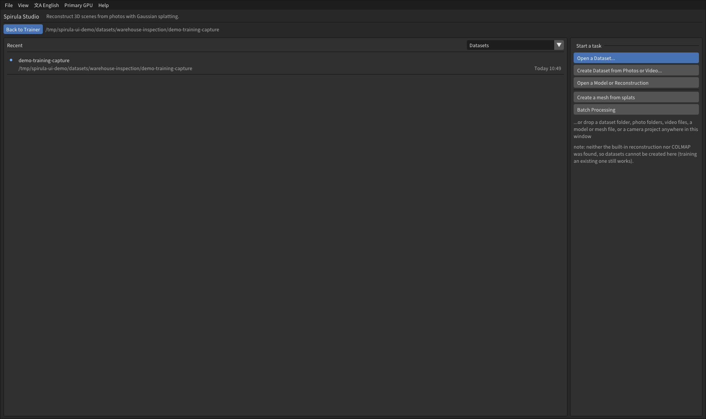 | 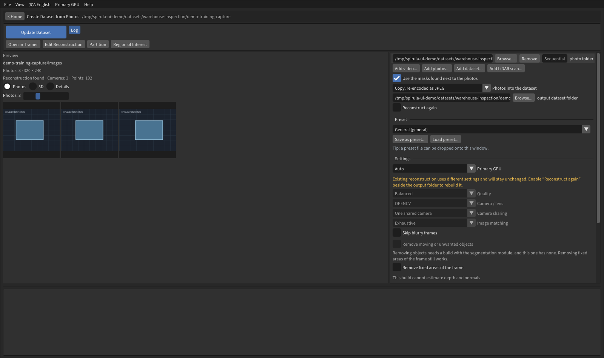 |

| Training | Model viewer |
| --- | --- |
| 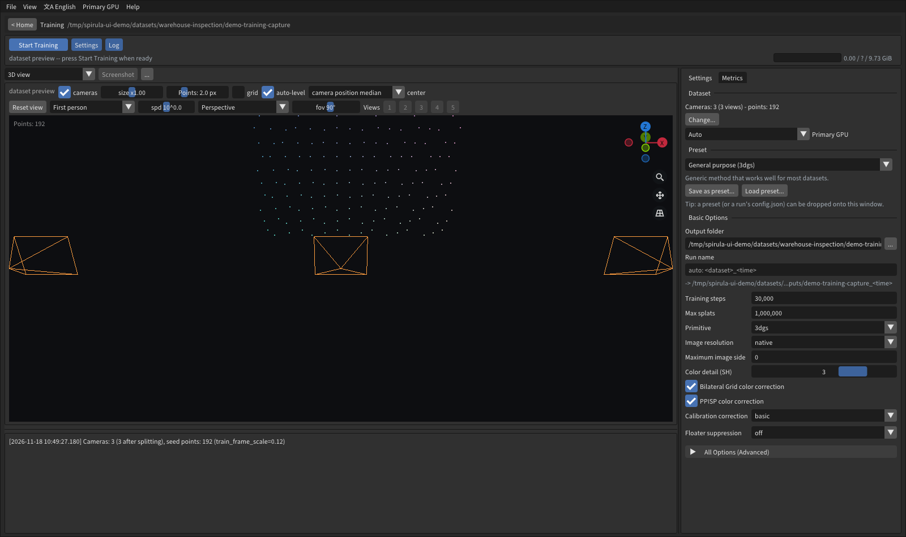 | 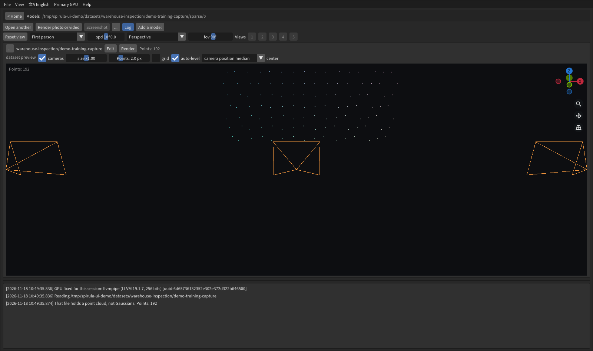 |

| Model edit | Render and timeline |
| --- | --- |
| 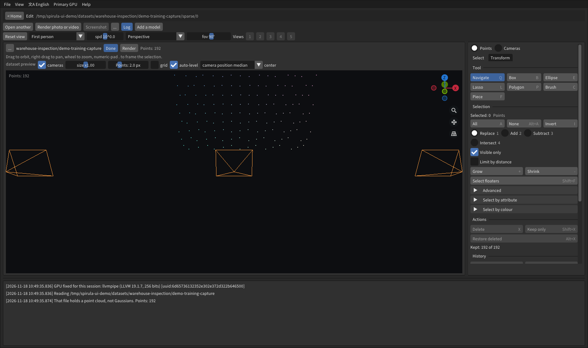 | 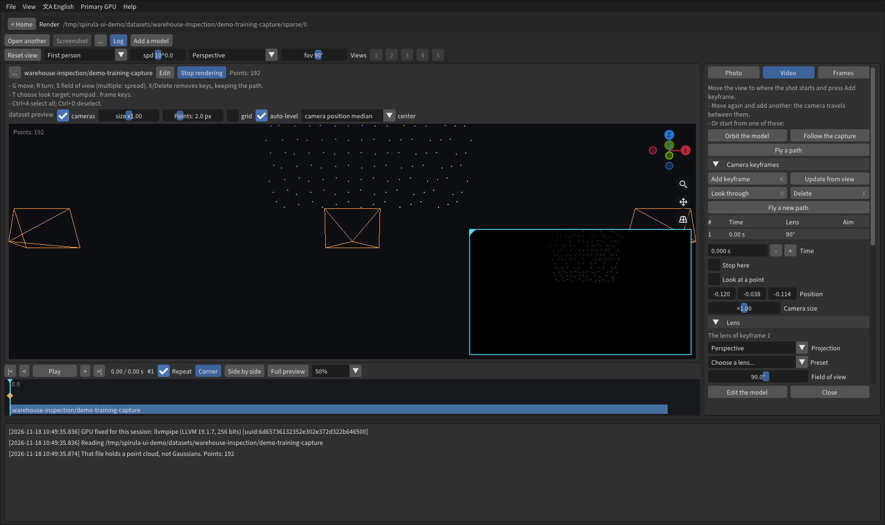 |

| Mesh preparation | Batch queue |
| --- | --- |
| 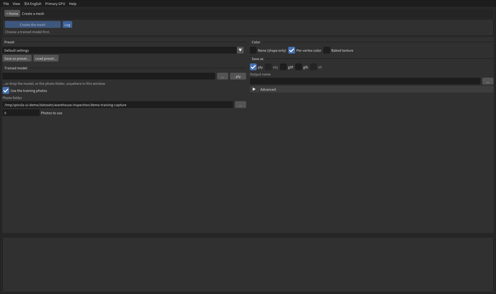 | 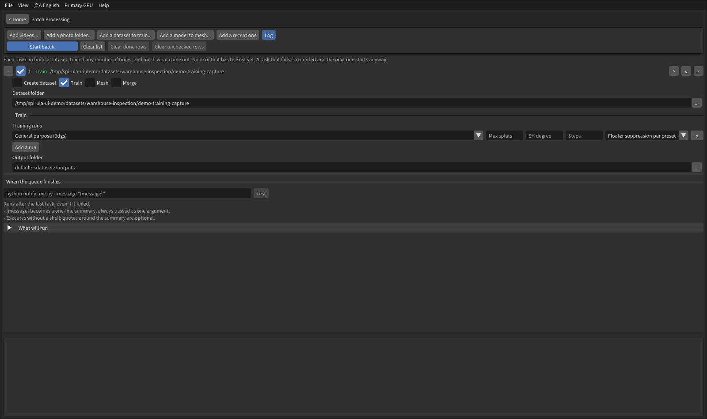 |

### Compact English workspace, 800 x 600

| Training settings | Render and timeline |
| --- | --- |
| 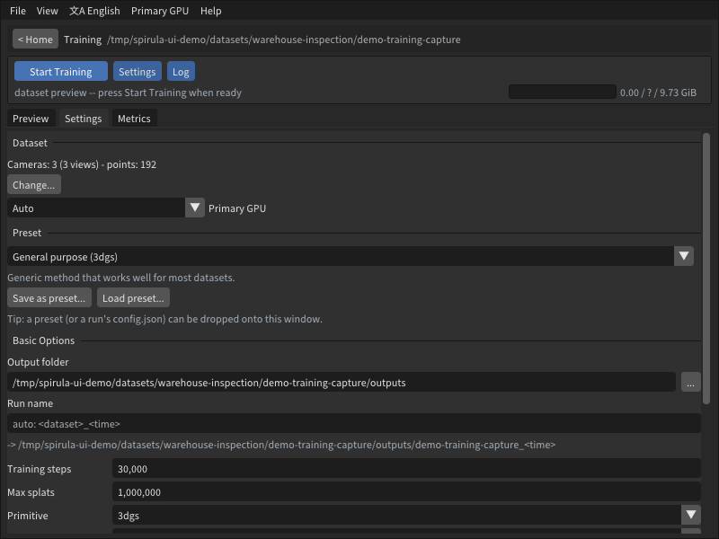 | 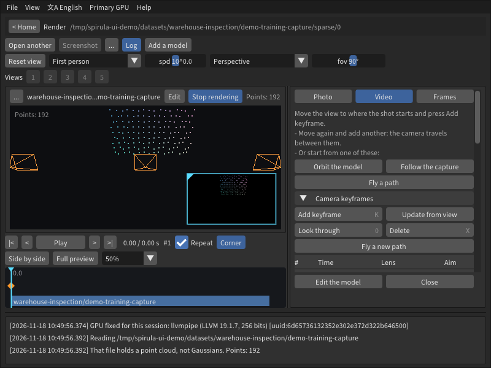 |

### Simplified Chinese, 200% UI scale

| Home | Dataset preview |
| --- | --- |
| 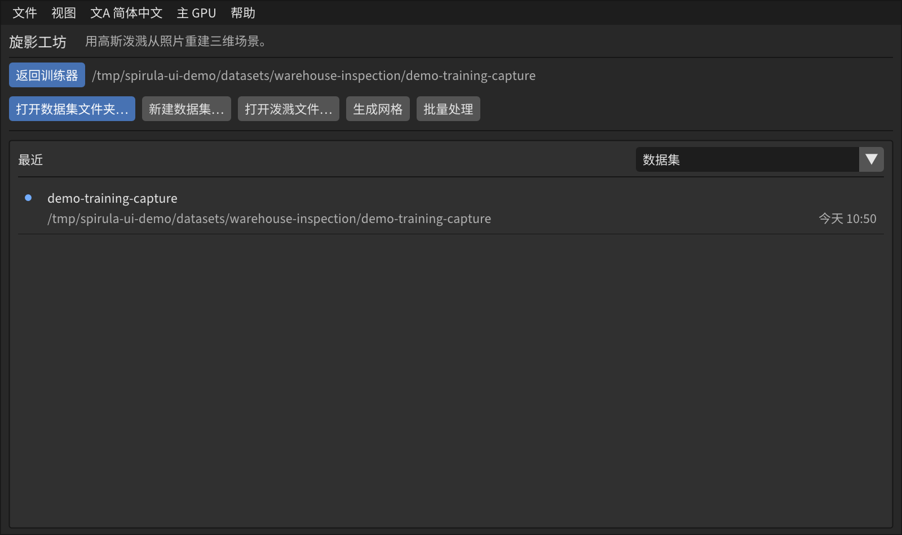 | 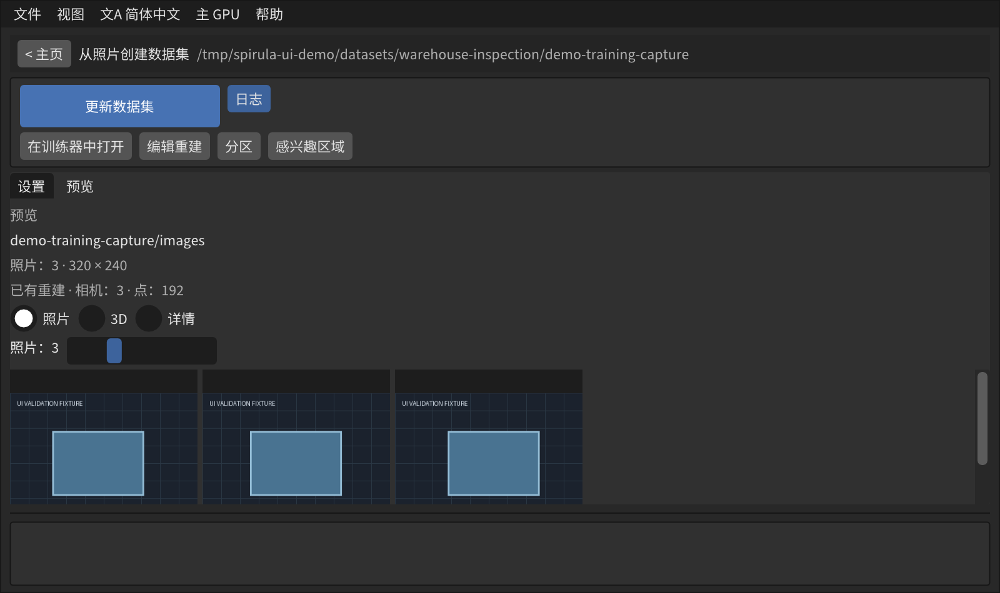 |

| Training settings | Render and timeline |
| --- | --- |
| 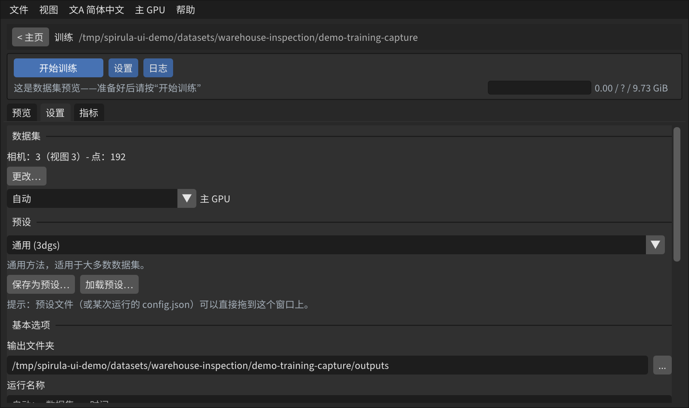 | 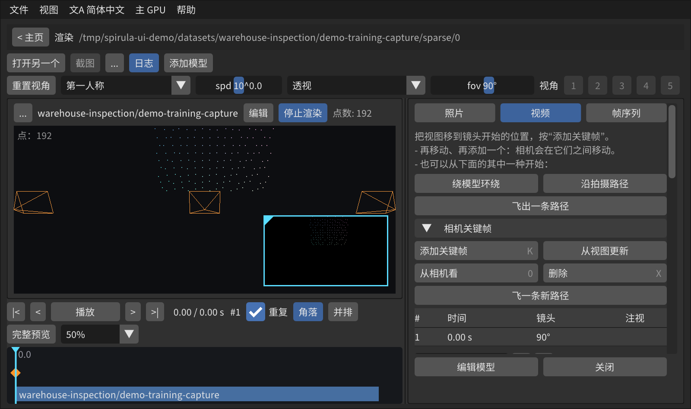 |
