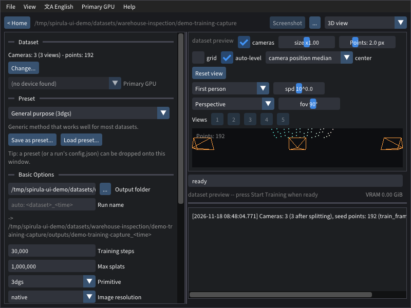
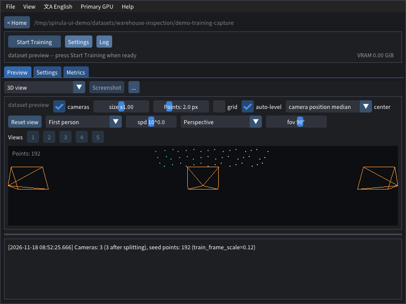
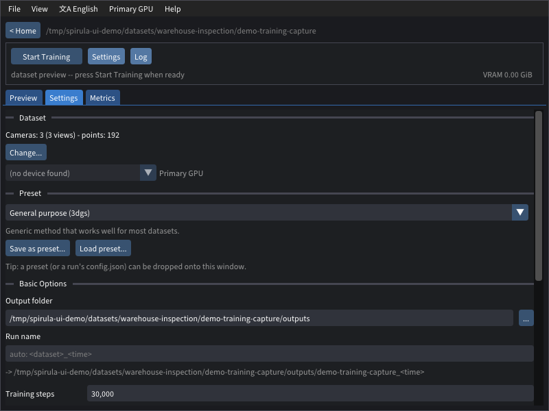
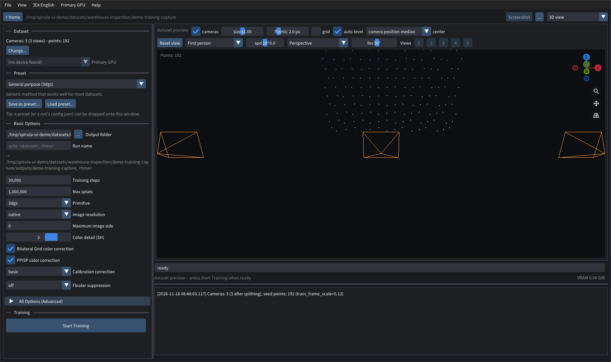
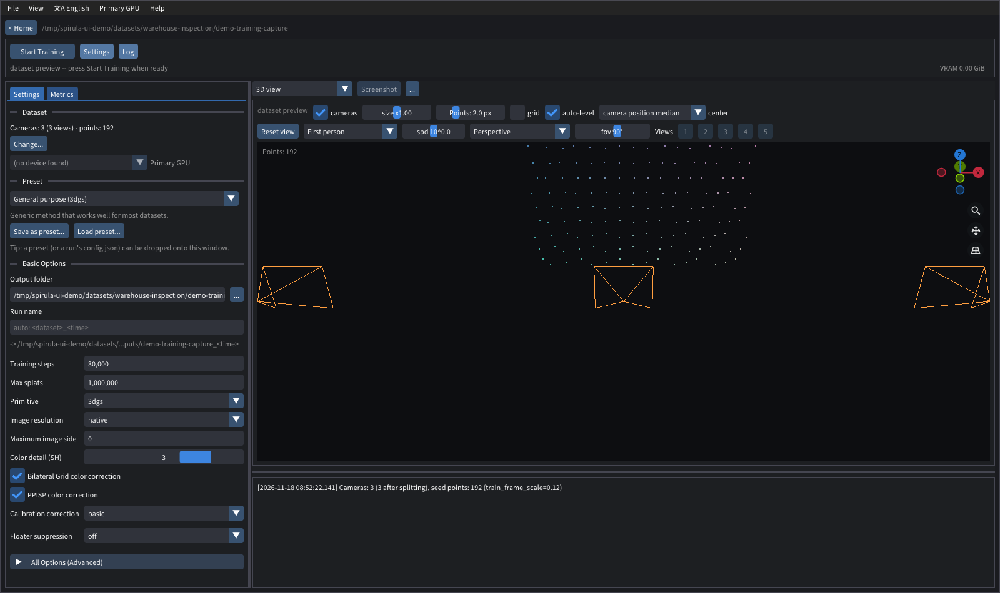
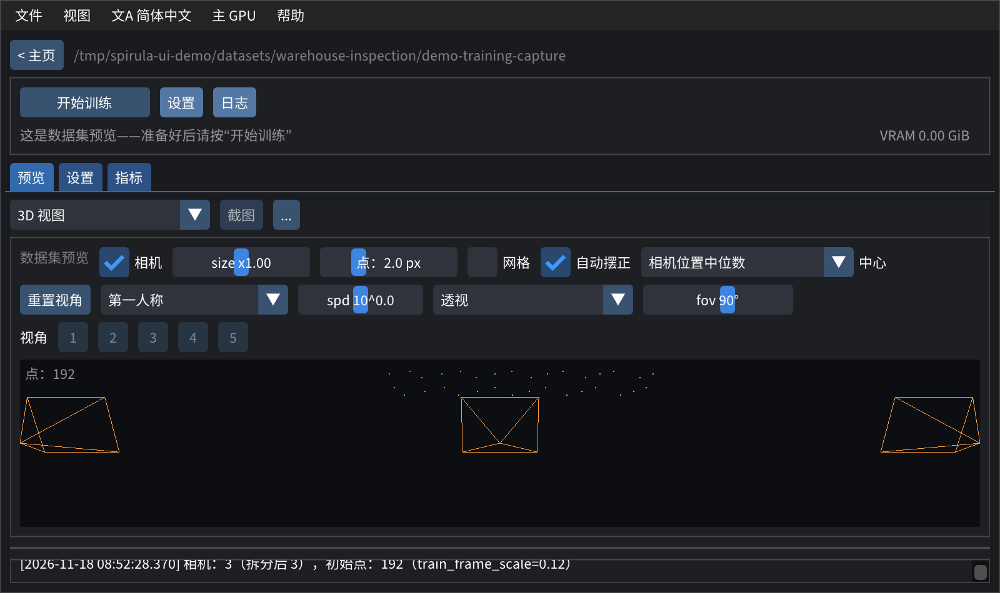

# Training workspace layout

> Historical record: this document describes the first training-workspace
> iteration committed as `0dbec1c`. Its screenshots, palette, and GPU-availability
> statements belong to that validation session. For the current overall Studio
> design, see [Studio workspace redesign](studio-workspace-redesign.md).

Training controls belonged to the bottom of the settings form. Scrolling
through advanced options, or hiding Settings, also hid Pause and Stop. Long
paths competed with header actions, and logs crowded short preview columns.
The workspace separates running a job, inspecting results, and configuration.

## Reading and task order

1. **Context:** Home, the batch-list entry when applicable, and the dataset path.
2. **Run:** Start, Pause/Resume, Stop, progress, timing, and VRAM stay outside the
   scrolling pages, together with Settings and Log toggles. Secondary actions
   use quieter button surfaces.
3. **Workspace:** the preview is the main work surface; Settings and Metrics
   provide separate inspection tasks, each with its own scroll area.
4. **Preview context:** the 3D/image switch, screenshot controls, and mask
   correction when available sit with the preview they describe.
5. **Diagnostics:** the log remains available below the preview within a bounded
   height. Empty Metrics explains when measurements become available.

## Space allocation

Fixed dimensions follow UI scale; the breakpoint uses available content width.

| Available width | Layout |
| --- | --- |
| At least `960 * scale` | A resizable inspector with Settings/Metrics tabs beside the preview. Its minimum width is 320; its maximum is the smaller of 45% of available width and the width left after reserving 480 for the preview and space for the splitter. |
| Below `960 * scale` | Preview, Settings, and Metrics become three full-width tabs. The action area stays visible above all three. |

Hiding Settings gives the preview the full body width and leaves the action
area available to restore it. Saved widths, log height, visibility preferences,
and UI scale remain. Resizing clamps the inspector without discarding its saved width.

The training log is capped at 30% of the height remaining after the run area
and preview toolbar. Its budget also reserves 240 scaled pixels for the preview
panel, plus splitter spacing. The log can shrink to zero when that budget is
unavailable; the saved Log visibility preference is retained. Its drag handle
uses the same cap as the layout, so dragging cannot bypass the preview budget.

## Fields and long content

Numeric and choice fields share an aligned label column when the longest
visible translation and a 170-pixel scaled editor fit. Otherwise the group
stacks labels above full-width editors. Paths and the run name always keep
their full-width rows. The output-directory editor reserves the measured
width of its browse button. Existing message-based field
IDs, configuration assignments, and manually touched fields are preserved;
dataset auxiliary controls keep their existing behavior.

Dataset and output paths use middle elision with the complete text on hover.
Run errors and download feedback use a bounded one-line summary with the full
message on hover. Progress text can wrap, and timing/VRAM details move to a new
row when necessary. Long content therefore does not push actions off the page.
Ready shows its existing start hint without an empty progress bar; active
training, preparation, evaluation, and completion retain their progress bars.

## Implementation and behavior

`src/app/gui/TrainingWorkspace.{h,cpp}` owns the responsive composition. Existing
panel functions supply its controls, settings, metrics, and preview content.
`FlowRow` in `Layout.{h,cpp}` extracts the viewport's existing measured-width
wrapping logic; the viewport and the new action rows share it. Explicit width
tracking keeps a hovered tooltip from changing the placement of the next item.

The existing start eligibility, pause/resume callback, stop confirmation,
saved/unsaved completion messages, and Render/Edit handoff remain. A batch keeps
its queue-specific stop actions; a training page cannot start a separate job
while the queue owns the runner. Log filtering, copying, and following remain.

`start_training()` resolves configuration macros before launching. This must
not depend on drawing Settings: the form may be hidden, or another tab may be
active when Start is pressed. The same resolver still updates visible settings
and respects manually touched values.

Three new messages cover Preview, Log, and the empty Metrics explanation, with
translations in all 13 supported languages. Other labels reuse the catalogs.
The dark palette, fonts, viewport navigation, and UI-scale preference remain.
The fixed responsive composition keeps panel recovery and persistence within
the existing layout model.

## Validation

- Built and linked the complete Vulkan GUI executable through `build_develop.bash`,
  with GUI enabled and SfM, SAM, and patented features disabled. The build used
  the pinned Slang compiler and a verified shader cache from the same base tree.
- Compiled the five affected GUI translation units: `GuiApp`, `TrainingWorkspace`,
  `Layout`, `Screenshot`, and `ViewportPanel`.
- Exercised the real ImGui workspace component with pointer interactions in
  12 size/language cases, including English, Chinese, and German. Checks covered
  independent scrolling, tab changes, splitter constraints, and same-frame toggles.
- Ran the complete GLFW/OpenGL application using Mesa software rendering and a
  synthetic dataset with 3 cameras and 192 points. Native interaction checks
  passed at 1600 x 950 / 100% English, 800 x 600 / 100% English, and
  1600 x 950 / 200% Simplified Chinese: switching Settings/Metrics, scrolling
  Settings, hiding the inspector, and hiding Log kept the run actions in place.
- Passed translation completeness, font coverage, UI text, comment length,
  Windows macro, SS prefix, private-path, and diff whitespace checks.

The native screenshots and interactions cover the Ready state. No compute GPU
was available, so active GPU training, pause/resume during training, batch
execution, and export were not run. Their existing state branches received
code review; they still need hardware validation.

## Visual review

These are captures of the real application, using the same synthetic dataset
and build feature flags for the before/after pair. The baseline is `df67d67`.
The generic dataset path belongs to the screenshot fixture.

### Compact window: 800 x 600, 100% UI scale

Before: Start Training is below the visible settings area, and the two narrow
columns leave little room for the preview.

After: run actions stay above the full-width workspace tabs. The preview and
its tools use the available width; Log remains bounded below them.

Switching to Settings gives the form the full width while retaining run access.

### Wide window: 1600 x 950, 100% UI scale

Before: run actions follow all settings, and status sits below the preview.

After: run actions and status share the fixed top area; the inspector holds
Settings/Metrics, and ordinary fields use aligned compact rows.

### Simplified Chinese: 1600 x 950, 200% UI scale

The scaled breakpoint selects the compact structure. Translated controls wrap
by their measured widths, and the preview keeps space ahead of the log.

## Manual review

1. Open a dataset, scroll Settings into advanced options, and hide the inspector;
   confirm the run actions remain reachable. Check Metrics before measurements.
2. Resize across the breakpoint, then use a larger UI scale and a long-label
   language. Switch each tab and drag the inspector without losing access to it.
3. Use long dataset/output paths; inspect the hover text and browse control.
4. Toggle and resize Log in a short window; check preview space and saved choices.
5. Check ready, preparing, paused, evaluating, completed, and error displays;
   inspect single-run stop confirmation and batch-specific stop controls.
